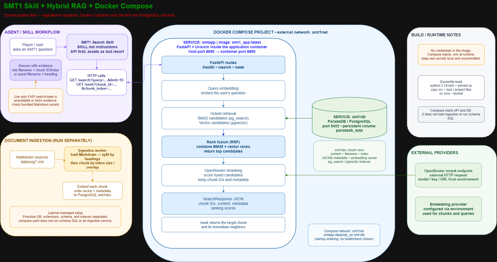

# Hybrid RAG for SMT1

A learning project that combines a local Shin Megami Tensei (SNES) search API,
an agent-facing skill, and a Docker Compose runtime. Markdown game-guide
documents are chunked and embedded for storage in PostgreSQL; searches combine
keyword and vector retrieval, fuse their rankings, and rerank a bounded set of
candidates before returning evidence for an answer.

The code and deployment scaffold are in place, but database provisioning,
schema setup, credentials, and document ingestion remain explicit operator
steps. Compose starts the API and database only; it does not create the
application schema or run ingestion.

## Architecture and flow



The editable draw.io source is [hybrid-rag-skill-docker-flow.drawio](./hybrid-rag-skill-docker-flow.drawio).

### Query path

1. The SMT1 search skill in `skill/SMT1_search_skill/SKILL.md` sends the
   question to the local API, starting with `GET /search`.
2. The API embeds the query and retrieves up to 20 semantic candidates and 20
   full-text candidates from PostgreSQL (`pgvector` and ParadeDB `pg_search`).
3. SQL combines the candidate rankings with Reciprocal Rank Fusion (RRF), then
   returns the requested result count.
4. The reranker scores only those fused candidates. The API returns chunk
   content, source filename, chunk identifiers, metadata, and scores.
5. If a useful passage needs surrounding text, the skill calls `GET /seek` for
   that chunk and its immediate neighbors. The skill uses bundled Markdown
   assets only when API search/seek is unavailable or does not provide enough
   evidence, and reports the source used.

### Ingestion path (separate from Compose)

Markdown files under `data/org/` are split by Markdown headings and then by
token size/overlap. The embedding provider generates a vector for each chunk;
the ingestion code writes chunk text, source information, metadata, and vectors
to the `smt1doc` table. This is a separate operation: there is no Compose
ingestion service.

## What is included

- **FastAPI service** — `GET /health`, `GET /search`, and `GET /seek`.
- **Hybrid retrieval** — SQL candidate retrieval with full-text BM25 and vector
  similarity, followed by RRF ranking.
- **Reranking** — external OpenRouter-compatible rerank endpoint, called with
  the bounded fused candidate list.
- **Ingestion and embeddings** — Markdown splitting, chunk embeddings, and
  PostgreSQL persistence code.
- **SMT1 search skill** — API-first lookup instructions, adjacent-chunk
  expansion, and evidence/source reporting.
- **Docker assets** — a Python API image and a Compose project with API and
  ParadeDB/PostgreSQL services, an external Docker network, and a persistent
  database volume.
- **Learning materials and tests** — `STUDY_NOTES.md`, sample source documents,
  SQL setup reference, and tests under `tests/`.

## Concepts learned

This project is also a hands-on guide to the ideas behind hybrid RAG. The
implementation is a working reference, while the important learning is
understanding why each stage exists and what trade-offs it introduces:

- **Document structure and chunking** — why to split Markdown by headings
  first, then split oversized sections by token-aware size; how chunk size,
  overlap, and carried metadata affect context and retrieval quality.
- **Embeddings and vector search** — how text becomes a vector, how vector
  distance finds semantically related chunks, and why the database vector
  dimensions must match the embedding model.
- **Keyword search and BM25** — how full-text search finds exact terms and
  terminology that semantic similarity may miss.
- **Hybrid retrieval and rank fusion** — why BM25 and vector search return
  separate candidate lists, why their raw scores are not directly comparable,
  and how Reciprocal Rank Fusion (RRF) combines their ranks.
- **Reranking** — why a reranker should score a bounded set of retrieved
  candidates rather than the whole corpus, and how to keep result IDs and
  metadata attached when ordering changes.
- **Grounded answers** — how chunk expansion through `/seek` supplies nearby
  context, and why answers should cite the source filename and chunk rather
  than fill gaps with guesses.
- **Service boundaries and configuration** — how the API, PostgreSQL,
  embedding/reranking providers, and agent skill interact; why external
  services and credentials are configured separately from application code.
- **Docker deployment boundaries** — what an API image and Compose services
  provide, and what remains an explicit operational step (database schema
  setup and ingestion).

Use [STUDY_NOTES.md](./STUDY_NOTES.md) for a deeper walkthrough of chunking
strategies. The learner still owns database provisioning and schema decisions;
review the SQL and experiment with retrieval settings rather than treating the
example defaults as universally optimal.

## Requirements and local setup

- Python 3.12 or newer for local development; the Docker image uses
  `python:3.14-slim`.
- [`uv`](https://docs.astral.sh/uv/) for Python dependencies and commands.
- Docker Engine with the Compose plugin for the containerized setup.
- A PostgreSQL/ParadeDB database with `pg_search` and `pgvector` available.
- Credentials and compatible embedding/reranking API endpoints and models.

Install the project dependencies:

```bash
uv sync
```

Copy `.env.example` to `.env`, then set the database username/password and the
provider credentials. `.env` is ignored by git; keep real secrets there and do
not commit them. The example uses `localhost:5432` for local runs and the
`paradedb` database. `DATABASE_SCHEMA` is `SMT1db`; PostgreSQL folds unquoted
identifiers to lowercase, so preserve the quotes around `"SMT1db"` if you use
that exact mixed-case schema name.

The SQL setup reference is [sql/create_table.sql](./sql/create_table.sql).
Review it and provision the database, schema, extensions, table, and indexes
yourself before ingesting or searching. The vector column is declared with a
fixed dimension, so it must match the embedding model's output. Neither the
application nor Compose applies this SQL automatically.

## Run locally

With the database provisioned, start the API from the project root:

```bash
uv run --env-file .env uvicorn hybrid_rag.api.main:app --reload --port 8890
```

The interactive API specification is available at
[`http://localhost:8890/docs`](http://localhost:8890/docs). The health endpoint
is `http://localhost:8890/health`.

To ingest the Markdown files in `INGEST_SOURCE_DIR` (default `./data/org`),
after the schema is ready and provider settings are configured:

```bash
uv run --env-file .env python -m hybrid_rag.rag.ingestion
```

Ingestion settings such as `CHUNK_SIZE` and `CHUNK_OVERLAP` are read from the
environment. Re-ingestion behavior should be considered before loading the same
sources more than once.

## Run with Docker Compose

The Compose file expects a local `.env`, an already-built `smt1_app:latest`
image, and an external Docker network named `smt1net`. From the repository root:

```bash
cp .env.example .env
# Edit .env and provide database and provider credentials.
docker network create smt1net
docker build -t smt1_app:latest .
docker compose -p smt1_service up -d
```

Compose overrides `DATABASE_HOST` to `smt1db` for the API container. The API is
published on port `8890`, and PostgreSQL on port `5432`. The `paradedb_data`
volume persists the database across container restarts. Stop the services
without deleting that data with:

```bash
docker compose -p smt1_service down
```

The database container initializes the configured database, but Compose does
not create the `SMT1db` schema, run `sql/create_table.sql`, or ingest documents.
Complete those learner-managed setup steps before using `/search`. Ingestion
also remains a separate command, not a Compose service.

## Configuration

All settings are supplied through environment variables; `.env.example` lists
the current names and example defaults.

| Group | Variables | Purpose |
|---|---|---|
| Database | `DATABASE_HOST`, `DATABASE_PORT`, `DATABASE_NAME`, `DATABASE_SCHEMA`, `DATABASE_USER`, `DATABASE_PASSWORD` | PostgreSQL connection. Use `localhost` for a local API process; Compose sets the API container's host to `smt1db`. |
| Embeddings | `EMBEDDING_API_BASE_URL`, `EMBEDDING_API_KEY`, `EMBEDDING_MODEL`, `EMBEDDING_REQUEST_TIMEOUT`, `EMBEDDING_RETRY_LIMIT`, `EMBEDDING_WAIT_TIME` | Provider, model, and request behavior for document and query embeddings. |
| Reranking | `RERANK_BASE_URL`, `RERANK_API_KEY`, `RERANK_MODEL`, `RERANK_REQUEST_TIMEOUT`, `RERANK_RETRY_LIMIT`, `RERANK_WAIT_TIME` | External rerank service configuration. |
| Ingestion/search | `INGEST_SOURCE_DIR`, `CHUNK_SIZE`, `CHUNK_OVERLAP`, `RETRIEVAL_LIMIT` | Source files and chunk/retrieval tuning. Confirm behavior and supported values in code before changing settings. |

Keep the embedding model's vector dimensions consistent with the database vector
column. Provider availability, model identifiers, and API limits are external
dependencies and may change.

## Project layout

```text
src/hybrid_rag/
  api/                 FastAPI routes and request/response schemas
  rag/                 Embeddings, ingestion, retrieval, and reranking
skill/
  SMT1_search_skill/   API-first SMT1 lookup instructions and fallback assets
data/org/              Markdown files used as ingestion sources
sql/                   Learner-reviewed database setup and query SQL
tests/                 API, ingestion, and model tests
Dockerfile             API image definition
compose.yaml           API + ParadeDB/PostgreSQL services
```

## Checks

Run the test suite and lint checks with:

```bash
uv run pytest
uv run ruff check .
```
